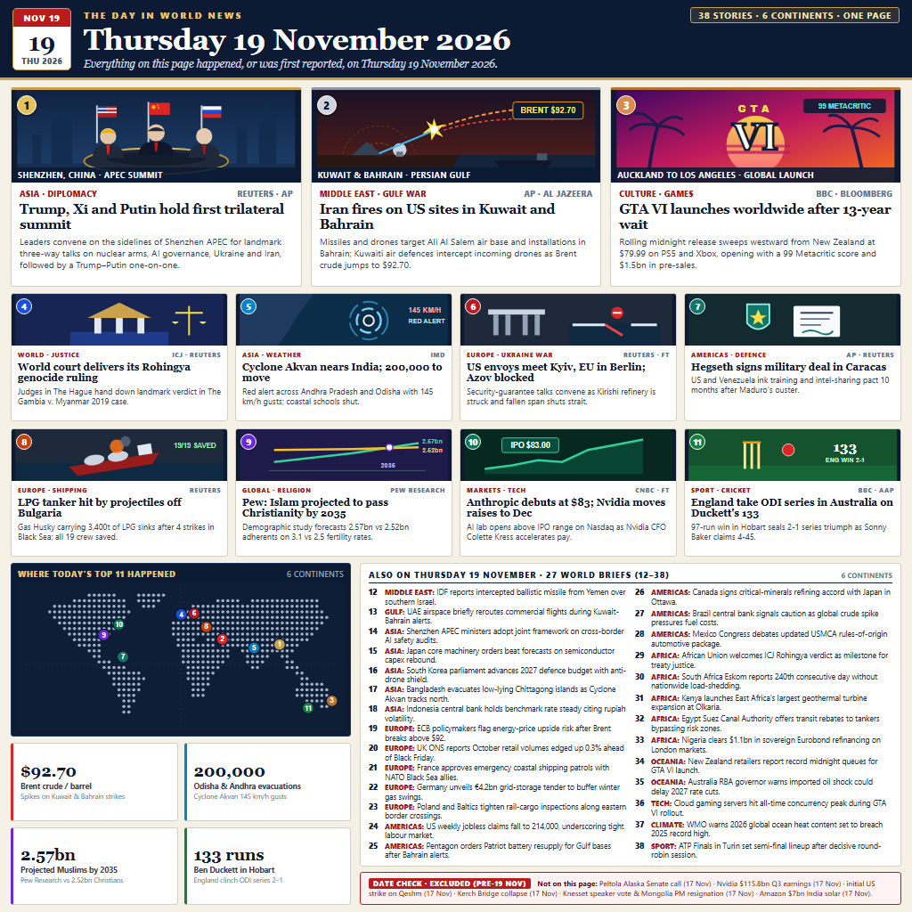

# Thursday 19 November 2026 — The Day in World News

[](https://make.fun/bounty/news-image-20261119?utm_source=github&utm_medium=readme&utm_campaign=news-image-20261119)
[](https://make.fun/bounty/news-image-20261119/leaderboard?utm_source=github&utm_medium=readme&utm_campaign=news-image-20261119)
[](https://make.fun/bounty/news-image-20261119/leaderboard?utm_source=github&utm_medium=readme&utm_campaign=news-image-20261119)

A single `1024×1024` editorial front-page broadsheet summarizing **38 verified world news stories across 6 continents** that happened — or were first reported — on **Thursday, 19 November 2026**.



## Editorial Design & Structure

- **Masthead**: Deep navy (`#0c1b33`) header with gold accent rule (`#c9a24b`), red/white date badge (`NOV 19 THU 2026`), Georgia serif broadsheet banner, and strict date-scope declaration.
- **Top Row — 3 Lead Stories**: Original vector illustrations with location captions and ranked badges (`1–3`):
  1. **Shenzhen APEC Trilateral Summit** — Trump, Xi, and Putin hold their first trilateral meeting covering nuclear arms, AI, Ukraine, and Iran.
  2. **Gulf War Escalation** — Iran fires on US military sites in Kuwait (Ali Al Salem) and Bahrain; Kuwait intercepts drones; Brent crude climbs to `$92.70`.
  3. **GTA VI Global Launch** — Midnight rolling launch from New Zealand westward at `$79.99` on PS5/Xbox, `99` Metacritic, `$1.5bn` pre-sales.
- **Middle Rows — 8 Illustrated Mid Cards (`4–11`)**: ICJ Rohingya genocide ruling, Cyclone Akvan evacuations in India, Berlin Ukraine security-guarantee talks & Azov strait closure, US–Venezuela defence pact in Caracas, *Gas Husky* LPG tanker strike off Bulgaria, Pew 2035 global religion projection, Anthropic `$83` Nasdaq debut & Nvidia pay move, and England's ODI series win in Hobart on Ben Duckett's `133`.
- **Bottom Left — World Map & Key Metrics**: 64×25 dot-matrix world map with numbered pins `1–11` and four KPI callout tiles (`$92.70`, `200,000`, `2.57bn`, `133 runs`).
- **Bottom Right — 27 World Briefs (`12–38`) & Date Check Bar**: Concise single-line dispatches across six continents plus an explicit red-bordered **DATE CHECK** bar noting major pre-19 November stories excluded from the edition.

## Running

Requires **Node.js 22+** (zero external dependencies):

```bash
node main.ts
```

`main.ts` validates `entry.png` (PNG/JPEG signature, `<= 1024×1024` dimensions, `<= 1 MiB` file size) and writes it to `process.env.MAKEFUN_OUTPUT_DIR || "/output"`.

To regenerate the broadsheet HTML source:

```bash
node render.mjs
```

## License

MIT — see [LICENSE](./LICENSE).
